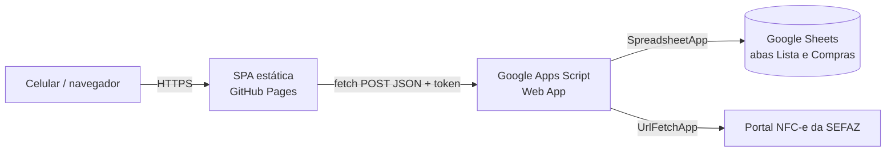

# Controle de Gastos — Lista de compras + NFC-e → Google Sheets

Uma SPA gratuita e open source para:

1. **Montar a lista de compras**, que fica salva na aba `Lista` da planilha.
2. **Ler o QR Code da NFC-e** (ou colar o link). O app consulta a nota na SEFAZ, extrai
   estabelecimento, data, itens e valores e grava tudo na aba `Compras`.
3. Ao importar a nota, **marcar como comprados** os itens da lista que aparecem nela.
4. Ver o **histórico de notas e o gasto do mês**.

Planilha: <https://docs.google.com/spreadsheets/d/1FyjzkPfp0D40FAzETEM7JQ_-I2CSNiSFO-_7gHgxmp4>

## Arquitetura (custo zero)



| Peça | Tecnologia | Por que |
|---|---|---|
| Frontend (SPA) | HTML + CSS + JavaScript puro, sem build | Hospedagem estática grátis; nada para compilar |
| Leitor de QR | [html5-qrcode](https://github.com/mebjas/html5-qrcode) (Apache-2.0), via CDN unpkg | Usa a câmera do celular pelo navegador |
| Hospedagem | GitHub Pages (pasta `docs/`) | Grátis, HTTPS (obrigatório para usar a câmera) |
| Backend / API | Google Apps Script publicado como App da Web | Grátis, acessa a planilha direto e faz a consulta à SEFAZ do lado do servidor (o navegador seria barrado por CORS) |
| Banco de dados | A própria planilha Google Sheets | Pedido do projeto; fácil de analisar com tabelas dinâmicas e gráficos |

**Alternativas grátis de hospedagem** da SPA: Cloudflare Pages, Netlify ou Vercel. Basta publicar a pasta `docs/`.

### Estrutura do repositório

```
apps-script/
  Code.gs            # API: lista, importação da NFC-e, histórico
  appsscript.json    # manifesto (fuso America/Sao_Paulo, V8, web app)
docs/                # SPA publicada no GitHub Pages
  index.html
  app.js
  style.css
  manifest.webmanifest
```

### Abas da planilha

**`Modelo`** (você mantém):
`(vazia) | Item | Periodicidade estimada | Setor | Unidade | Quantidade | Valor Unitário (R$) | Valor Total (R$) | Local | Comprado`
- É a referência de layout: as abas `Lista` e `aaaammdd` são criadas com **exatamente** este cabeçalho,
  formatação, largura de colunas e linha congelada. Se você mudar o Modelo, as abas novas seguem a mudança.
- As colunas são localizadas pelo nome do cabeçalho, sem diferenciar acentos ou maiúsculas.
- A periodicidade aceita `Semanal`, `Quinzenal`, `Mensal` ou `Demanda` (também "semanais", "sob demanda"…).

**`Lista`** — a lista de compras **única e compartilhada**, no formato do Modelo:
- A coluna A (sem título) guarda o ID de cada item. Não apague nem edite essa coluna. Itens digitados
  direto na planilha, sem ID, ganham um automaticamente.
- `Comprado` é uma caixa de seleção. `Valor Total` é a fórmula `Quantidade × Valor Unitário`.
- **Vários usuários ao mesmo tempo**: cada ação grava só o campo alterado, localizado pelo ID (não pela
  posição da linha), e as gravações passam por um bloqueio do Apps Script, uma de cada vez. O app recarrega
  a lista a cada 15 segundos. Dá para editar também direto na planilha.
- *Nova lista* acrescenta os itens do Modelo das periodicidades marcadas. Não apaga nada, não duplica
  itens já presentes e faz itens já comprados voltarem a ficar pendentes.
- *Remover itens comprados* exclui da aba as linhas com `Comprado` marcado.
- Ao importar uma nota, os itens pendentes que casam com produtos da nota ficam com `Comprado` marcado e
  recebem quantidade, unidade, valor unitário pago e local. O casamento tenta primeiro "todas as palavras
  do item na descrição" e depois "a primeira palavra" (ex.: `Carne (patinho/alcatra)` ↔ `CARNE PATINHO KG`).

**`aaaammdd`** (ex.: `20261115`) — a compra do dia, no formato do Modelo:
- Criada ao importar a primeira nota daquela data. Notas do mesmo dia entram na mesma aba.
- Uma linha por produto da nota: coluna A = chave da nota, `Item` = descrição na nota, `Comprado` marcado.
- Se já existir uma aba com esse nome em outro formato (versão anterior do app), ela é renomeada para
  `aaaammdd_antiga` e uma nova é criada.

**`Compras`** (uma linha por item da nota, na mesma ordem de colunas do Modelo):
`ChaveNFCe | Item | Periodicidade | Setor | Unidade | Quantidade | Valor Unitário | Valor Total | Local | Data Compra`
- `Setor` e `Periodicidade` vêm do item da lista conciliado ou, se não houver, do item do Modelo que casar.
- Valores no formato `NN,NN`, sem `R$` (requer a planilha com localidade Brasil: Arquivo → Configurações).
- Notas repetidas são detectadas pela chave de 44 dígitos e não são gravadas de novo.
- Uma aba `Compras` em layout antigo é convertida automaticamente, mantendo os dados.

**`Log`**: `DataHora | Acao | Chave | Erro | Detalhe | Url` — cada falha de importação da NFC-e
(SEFAZ fora do ar, HTTP de erro, captcha, layout não reconhecido) com título e trecho da página recebida.

### API (POST com corpo JSON, `Content-Type: text/plain`)

Todas as chamadas levam `{ "action": "...", "token": "..." }`.

| action | parâmetros | retorno |
|---|---|---|
| `ping` | — | versão e hora |
| `resumoModelo` | — | total de itens do Modelo, contagem por periodicidade e lista de setores |
| `criarLista` | `frequencias` (`["Semanal","Mensal",…]`; vazio = Modelo inteiro) | `{adicionados, reativados}` |
| `listarItens` | — | itens da aba Lista |
| `adicionarItem` | `item: {item, quantidade, setor?, unidade?}` | item criado |
| `atualizarItem` | `id, campos: {comprado?, quantidade?, unidade?, item?, setor?}` | — |
| `removerItem` | `id` | — |
| `removerComprados` | — | `{removidos}` |
| `importarNfce` | `url` (link do QR) e/ou `html` (página colada) | nota, itens, `aba` (aaaammdd), `marcados`, `foraDaLista` |
| `listarCompras` | `limite?` | notas agrupadas, `totalMes`, `totalGeral` |
| `detalharCompra` | `chave` | itens da nota |

## Instalação passo a passo

### 1. Backend (Apps Script)

1. Abra a planilha → **Extensões → Apps Script**.
2. Apague o conteúdo de `Código.gs` e cole o de [apps-script/Code.gs](apps-script/Code.gs).
3. Em **Configurações do projeto** (engrenagem), marque *"Mostrar arquivo de manifesto appsscript.json"*
   e cole o conteúdo de [apps-script/appsscript.json](apps-script/appsscript.json).
4. Selecione a função **`setup`** e clique em **Executar**. Autorize o acesso (planilha e requisições externas).
   No **Registro de execução** aparece o **token de acesso**; guarde-o.
5. **Implantar → Nova implantação →** tipo **App da Web**
   - Executar como: **Eu**
   - Quem pode acessar: **Qualquer pessoa**
6. Copie a **URL do App da Web** (termina em `/exec`).

> A URL é pública, mas toda ação exige o token. Para trocar o token, rode `trocarToken()`.
> Ao alterar o `Code.gs` depois, use **Implantar → Gerenciar implantações → Editar → Nova versão**
> para manter a mesma URL.

Opcional: use o [clasp](https://github.com/google/clasp) (`npm i -g @google/clasp`) para enviar o código pelo terminal com `clasp push`.

### 2. Frontend (GitHub Pages)

```bash
git init
git add .
git commit -m "Controle de gastos"
git branch -M main
git remote add origin https://github.com/<seu-usuario>/gastos.git
git push -u origin main
```

No GitHub: **Settings → Pages → Build and deployment → Deploy from a branch → `main` / `/docs`**.
O site fica em `https://<seu-usuario>.github.io/gastos/`.

### 3. Primeiro uso

1. Abra o site, vá em **Config**, cole a URL do Web App e o token e clique em **Salvar e testar**.
2. Clique em **Copiar link de configuração** e abra esse link no celular. Ele já chega configurado.
3. No celular, use *"Adicionar à tela inicial"* para usar como um app.

## Como usar

- **Lista**: mostra a aba `Lista`, a mesma para todos os usuários, e se atualiza sozinha a cada 15 s.
  Toque em *Nova lista* e marque as periodicidades do Modelo (semanais, quinzenais, mensais, demanda)
  para incluir esses itens.
  - As colunas são **Setor**, **Item** e **Quantidade**, em ordem alfabética de setor e depois de item.
  - A coluna **Quantidade** é editável: tipo de unidade (`UN` ou `KG`) e o número.
  - Adicione itens avulsos (setor e unidade opcionais), marque o que comprou e use *Remover itens
    comprados* para excluí-los da aba `Lista`.
- **Escanear**: toque em *Ler QR Code da nota* e aponte para o QR do cupom. Ou cole o link.
  A nota é gravada nas abas `Compras` e `aaaammdd` (data da compra), e os itens correspondentes da
  `Lista` ficam marcados como comprados.
- **Compras**: histórico das notas (toque em uma para ver os itens) e o total do mês.
- Também dá para importar abrindo `https://<site>/?nfce=<link-da-nota>`.

## Limitações e como contornar

- **Layout por estado.** O parser `parserPadraoSefaz_` lê o portal de consulta padrão
  (`#tabResult`, `txtTit`, `Rqtd`, `RvlUnit`, `totalNumb`), usado pela maioria das SEFAZ (SP, RS/SVRS, PR, BA,
  GO, PE, SC, DF, ES…). Estados com página própria, como MG ou RJ, podem precisar de um parser extra:
  escreva uma função `(html, url) => nota` e adicione-a ao array `PARSERS` em `Code.gs`.
- **Bloqueio ou captcha da SEFAZ.** O Apps Script roda em servidores do Google (fora do Brasil). Alguns
  portais bloqueiam esses acessos ou pedem captcha. Nesse caso, use *Importação manual*: abra a nota no
  navegador, copie o código-fonte da página e cole no app.
- **Associação lista ↔ nota** é aproximada: o item é marcado quando todas as palavras do nome (3 letras ou
  mais), ou ao menos a primeira, aparecem na descrição do produto. Descrições muito abreviadas
  ("ARR TJ 5K") podem não casar.
- **Edição simultânea**: duas pessoas mudando o *mesmo campo do mesmo item* ao mesmo tempo — vale a última
  gravação. Os outros usuários veem a mudança em até 15 s.
- **Não reordene a aba Lista pela planilha** enquanto alguém usa o app. O app acha os itens pelo ID e
  continua funcionando, mas a fórmula de `Valor Total` pode ficar apontando para outra linha.
- **Cotas grátis do Apps Script** (conta pessoal): cerca de 20 mil chamadas `UrlFetch` por dia e 6 minutos
  por execução. Sobra para uso doméstico.

## Ideias de evolução

- Aba `Resumo` com fórmulas `QUERY`/tabela dinâmica por mês, estabelecimento e categoria.
- Categorizar os produtos automaticamente por palavra-chave ou código NCM.
- Comparar o preço do mesmo EAN (`Codigo`) entre mercados e ao longo do tempo.
- Service worker para abrir a lista mesmo sem internet.
